# Домашнее задание 3 — Метрики и алертинг пути оформления заказа

> Тестовый репозиторий, который необходимо форкнуть и развернуть локально - https://github.com/dakmaev1440/sre-observability-lab

## 📋 Контекст

Покупатель сообщает, что оформление заказа иногда задерживается и не
проходит. Команда видит общие графики (RPS, p95, доля 5xx), но **не видит
главного**: успешно ли проходит оплата и **по какой причине она падает**.
Внешне всё «работает» — ответы 200, статус сервиса UP — а продажи стоят.

## 💬 Запрос заказчика

*«Помогите понять, где уходят покупки: не проходят оплаты, и непонятно почему
— это ломается сервис, или просто карты отклоняются? Когда нет покупок две
минуты подряд — сообщайте сразу. Не будите дежурного из-за единичного отказа
карты: отличайте технический сбой от бизнес-отказа.»*

---

## 🎯 Что нужно замониторить

Добавь **одну бизнес-метрику** (счётчик и, при желании, гистограмму
длительности) для пути `POST /api/orders`, которая несёт причину исхода
оплаты. Причины (уже реально используются в коде, смотри `backend/main.go`
и `backend/internal/payment`):

| `result` / `failure_reason` | Что это | Тип |
|---|---|---|
| `paid` | Оплата прошла, заказ успешен | успех |
| `card_declined` | Банк отклонил карту (заказ создан, оплата не прошла) | **бизнес-отказ** |
| `issuer_timeout` | Банк не ответил вовремя | **технический сбой** |
| `issuer_unavailable` | Банк недоступен | **технический сбой** |
| `db_unavailable` | БД payment недоступна | **технический сбой** |
| `payment_service_unavailable` | Возвращено backend'ом, когда payment недоступен / ретраи исчерпаны / circuit breaker разомкнут | **технический сбой** |
| `out_of_stock` | Не хватает остатков, заказ не создан (409) | бизнес (не оплата) |

Имя метрики и имена label'ов выбери **сам** (соответствие неймингу
Prometheus, namespace `backend` уже используется в проекте). Обоснуй:
- какие label'ы несут смысл (причина/тип исхода), а какие — шум;
- помни про кардинальность: никаких `user_id`, `order_id`, `request_id`,
  `product_id` в labels;
- `failure_reason` из БД — это исчерпывающее множество значений, а **не**
  то, что должно стать label'ом один-в-один: подумай, нужно ли сгруппировать
  несколько технических причин в одно значение или оставить детально —
  и обоснуй выбор с точки зрения кардинальности и читаемости алертов.

> ⚠️ **Наверняка** этот счётчик ещё **не существует** — проверь `/metrics`
> у backend и `backend/internal/obs/business_metrics.go`. Если вдруг появился
> — отметь это в отчёте и обоснуй, что добавлять нечего. Ожидается, что тебе
> предстоит **написать код**.

Дополнительно:
- гистограмма длительности checkout с **тем же** label исхода — длительность
  отдельно по успеху и по типам отказа (чтобы отделить «медленные, но
  успешные» от «медленно падающих»).

---

## 📚 Постановка задания

1. **Инструментируй checkout.** Добавь счётчик (и, при желании, гистограмму
   длительности) с label'ом исхода оплаты, как описано в разделе «🎯 Что
   нужно замониторить». Каждый исход `POST /api/orders` должен инкрементировать
   ровно один label-набор.
    - Убедись, что labels ограничены и не содержат `user_id`, `order_id`,
      `request_id` — это личные данные и кардинальный взрыв.
    - Покажи, что `card_declined` инкрементируется **не** как техническая
      ошибка.

2. **Настрой минимум три алерта** на эту метрику, разного смысла (см.
   спецификацию ниже).

3. **Проведи два контролируемых эксперимента** через админ-панель /
   `/admin/chaos` payment:
    - **нормальный** запрос (оплата прошла),
    - **технический отказ** (например `issuer_timeout` или `db_unavailable`),
    - (по желанию) **бизнес-отказ** `card_declined`.
      Зафиксируй, как каждый симптом отражается в метрике → трейсе → логе,
      и как это поднимает / НЕ поднимает алерты.

4. **Напиши отчёт** в этом файле и **короткий runbook** по правилам.

---

## 🔔 Требования к алертам

Спроектируй **минимум три правила** на новую метрику checkout. Для каждого
правила ты **сам** пишешь PromQL, выбираешь `severity`, порог и `for:` —
и обязан обосновать каждый выбор. Готовых запросов здесь нет: цель — чтобы
ты продумал, от какого сигнала и как алерт срабатывает, а не скопировал.

Общие требования к `for:` — покажи, что этот параметр привязан к симптому,
а не выбран наугад:
- если задержка срабатывания критична для покупателя, а ложные срабатывания
  маловероятны — `for:` должен быть маленьким (или `0s`);
- если правило чувствительно к коротким всплескам / единичным запросам —
  `for:` должен быть больше, чтобы гасить шум, но обосной именно это.

### Правило 1 — технический сбой оплаты 💥
- **Что.** Отдели технические сбои оплаты
  (`issuer_timeout`, `issuer_unavailable`, `db_unavailable`,
  `payment_service_unavailable`) от успехов и бизнес-отказов.
- **Симптом.** Доля технических сбоев среди всех попыток checkout растёт —
  зависит от **доли** (rate тех-ошибок / rate всех попыток), а не от
  абсолютного числа. Подумай, как не делить на ноль при отсутствии трафика.
- **Severity.** Это деградация платформы → `critical` (page).
- **Что НЕ должно триггерить:** `card_declined`. Проверь, что твоё выражение
  физически не может зацепить бизнес-отказ.
- **Обоснуй:** как связал порог с реальным symptom'ом и какой `for:` выбрал.

### Правило 2 — 2 минуты без единой покупки 📉
- **Что.** Следи за подтверждёнными покупками (значение «успех» в твоей
  метрике).
- **Симптом.** В течение **2 минут подряд** — ни одного `paid`, **но** при
  этом были попытки оформления (иначе это не «проблема», а просто тишина).
- **Severity.** Торговля вслепую, страдает покупатель → `critical` (page).
- **Обязательное условие дизайна:** правило **не должно** палить в спокойное
  время, когда никто ничего не покупает. Придумай, как отличить «ни одной
  покупки, потому что никого нет» от «ни одной покупки, хотя заказывают».
- **Обоснуй:** почему `for:` здесь, скорее всего, почти нулевой.

### Правило 3 — всплеск бизнес-отказов (без page) 🚩
- **Что.** Следи за `card_declined` отдельно от технических сбоев.
- **Симптом.** Доля отказов карт среди всех попыток резко выросла
  (например, «почти все карты отклоняются»). Единичный `card_declined` —
  норма, а вот массовое — уже подозрение на проблему (неверный платёжный
  контракт, тестовый трафик, сломанный checkout).
- **Severity.** `warning` (**не page**, идёт в ticket). Обоснуй, почему
  бизнес-отказ сам по себе не должен будить дежурного.
- **Обоснуй:** почему `for:` здесь должен быть **больше**, чем в правиле 1
  (ловить устойчивый тренд, а не короткий всплеск).

### Правило 4 (бонус) — ингибирование, защита от дублей
- Если уже горит **технический** сбой (page) — погасить менее срочный
  **бизнес**-алерт, чтобы не спамить в один канал.
- Объясни, **почему этого шага достаточно**: `card_declined` — штатный ответ
  банка, возвращает HTTP 200 и не должен размыкать circuit breaker (это уже
  заложено в `BusinessDecline.IsSuccessful`).

### Правило 5 (бонус) — маршрутизация, два уровня реакции
В `alertmanager.yml` раздели по `severity`:
- `critical` → receiver `oncall-webhook` (page-канал),
- `warning` → receiver `ticket-webhook` (низкоприоритетный).
- Покажи `route` и `group_by`, обоснуй группировку (по `alertname`, по
  `service`).

---

## 🔎 Шаги для проверки (сценарий)

1. `docker compose up --build -d`, подожди готовности.
2. **Норма:** залогинься, купи товар → в твоей метрике у значения «успех»
   +1; алерты не горят.
3. **Технический сбой:** через админ-панель задай payment chaos:
   `stage=bank`, `fail_rate=1.0`, `fail_kind=issuer_timeout` (или
   `db_unavailable`). Соверши покупку → `result` с тех-отказом +1. Следи:
   сработает ли `CheckoutPaymentsFailing`, потом `CheckoutZeroPurchases`;
   открой трейс `checkout.process → payment.request → bank.authorize` и лог
   `checkout failed: payment service degraded` по `trace_id`.
4. **Бизнес-отказ** `card_declined`: переключи `fail_kind=card_declined`,
   купи → увидишь в метрике значение бизнес-отказа, но **никакой**
   тех-аварии. Проверь, что breaker НЕ открылся (состояние CLOSED).
5. Верни chaos в `0` → убедись, что `paid` снова растёт и алерты переходят
   в `resolved`.
6. Зафиксируй **firing → resolved** для каждого алерта.

---

## 🧾 Обязательный раздел отчёта (продолжи ниже)

Заполни по шагам:

1. **Архитектура** — куда добавил метрику, как она пишется (схема/фрагмент
   кода), какие labels и почему.
2. **Команды** — как поднять стенд, как воспроизвести нормальный/ошибочный
   запрос, как посмотреть свою метрику (`curl .../metrics | grep` по выбранному
   имени), как достать трейс и лог по одному `request_id`.
3. **Улики** — скриншоты или экспортированные запросы: метрика по `result`,
   искомый трейс, лог с `trace_id`, алерт firing/resolved.
4. **Алерты** — таблица: правило → симптом → порог и `for:` → маршрут
   (severity/page|ticket).
5. **Вывод о поведении checkout** — что на самом деле происходило при
   тех. сбое vs при `card_declined`, что выберешь в качестве SLI по оплате.

---

## 🎯 Формат оценивания

Прикрепи ссылку на pull request (обязательно) и по желанию — скринкаст
3–5 минут.

| Артефакт | Требование |
|---|---|
| Метрика checkout | счётчик с label'ом исхода оплаты и обоснованными labels; `card_declined` отдельно от тех. сбоев |
| Алерты | минимум 3 правила (тех. сбой, «нет покупок», бизнес-отказ/всплеск) + обоснованные `for:` |
| Маршрутизация | минимум 2 уровня (page/ticket) + группировка; для `card_declined` объяснено отсутствие page |
| Runbook | короткий: проверка, безопасные шаги, эскалация, чего не делать |
| Отчёт | в этом файле: архитектура, команды, улики, таблица и вывод |
| Проверка | firing → resolved; норма vs отказ по метрике → трейсу → логу |

---

## ⭐ Балловая система

Максимум **200** (по 100 на раздел).

### Метрика и инструментация (100)

| Критерий | неуд. | уд. | хор. | отл. |
|---|---|---|---|---|
| Метрика причины отказа | нет — **0** | есть счётчик, но `result` не разделяет бизнес/тех — **10** | разделяет, labels корректны — **20** | + гистограмма длительности и обоснованные бакеты — **25** |
| `card_declined` обработан особым образом | — **0** | инкрементируется как ошибка — **10** | не считается тех. ошибкой — **20** | + показан HTTP 200 и неоткрытие breaker — **25** |
| Логи/трейс связаны | нет — **0** | в одном компоненте — **10** | общий `request_id`+`trace_id` по пути — **20** | следствие по одному `request_id` подтверждено — **25** |
| Отчёт | нет — **0** | только описание — **5** | команды+улики — **15** | другой студент может повторить — **25** |

### Алертинг (100)

| Критерий | неуд. | уд. | хор. | отл. |
|---|---|---|---|---|
| Правила | не работают — **0** | одно — **10** | ≥3 осмысленных — **20** | пороги и `for:` привязаны к симптомам и шуму — **25** |
| «Нет покупок 2 мин» | нет — **0** | счётчик нуля без фильтра — **10** | с фильтром «были попытки» — **20** | не спамит в тихое время + подтверждено — **25** |
| Разделение бизнес/тех | нет — **0** | в одном правиле — **10** | разные правила/severity — **20** | объяснено отсутствие page у `card_declined` — **25** |
| Доказательства | нет — **0** | только YAML — **5** | firing/resolved — **15** | воспроизводимо, включая маршрут — **25** |


---
 
# Отчет по ДЗ 3
 
Время в логах указано в UTC. В Grafana время показано в UTC+3.
 
## 1. Архитектура
 
Метрики исходов оплаты в проекте не было. Я проверил `backend/internal/obs/business_metrics.go` и `/metrics` backend: там есть только метрики пользователей, склада и отзывов. Поэтому метрику я написал сам.
 
**Что я изменил**
 
- `backend/internal/obs/checkout_metrics.go` (новый файл): счетчик `backend_checkout_attempts_total{result, failure_reason}`, гистограмма `backend_checkout_duration_seconds{result}`, функция `RecordCheckout`.
- `backend/internal/obs/business_metrics.go`: добавил два поля в структуру и вызов инициализации.
- `backend/main.go`: в обработчике `POST /api/orders` в каждой точке исхода выставляются `checkoutResult` и `checkoutReason`. Запись метрики делает один `defer` в конце обработчика. Он же добавляет исход в атрибуты спана `checkout.process`.
- `backend/internal/payment/payment.go`: добавил передачу заголовка `X-Request-ID` в payment. Без этого в логах payment был `"request_id":"unknown"`, и по одному request_id нельзя было связать логи двух сервисов.
- `vmalert/alerts.yml` и `alertmanager/alertmanager.yml`: три правила, маршруты по severity, ингибирование.
- `alertreceiver/main.go`: добавил в лог поле `receiver`, чтобы видеть, в какой канал ушел алерт.
**Как метрика записывается** (фрагмент `main.go`):
 
```go
checkoutStart := time.Now()
checkoutResult, checkoutReason := "", ""
defer func() {
    if checkoutResult == "" { return }
    span.SetAttributes(
        attribute.String("checkout.result", checkoutResult),
        attribute.String("checkout.failure_reason", checkoutReason),
    )
    bizMetrics.RecordCheckout(checkoutResult, checkoutReason, time.Since(checkoutStart))
}()
```
 
Благодаря `defer` на каждую попытку приходится ровно один инкремент при любом `return`.
 
**Labels**
 
| Label | Значения | Назначение |
|---|---|---|
| `result` | `paid`, `business_decline`, `technical_failure`, `out_of_stock` | класс исхода, по нему написаны алерты |
| `failure_reason` | `none`, `card_declined`, `payment_service_unavailable`, `out_of_stock` | детали внутри класса |
 
Всего получается 4 временных ряда. `user_id`, `order_id`, `request_id` и `product_id` в labels я не добавлял: у них очень много уникальных значений, это увеличивает кардинальность. Эти значения есть в логах и трейсах.
 
**Технические причины я сгруппировал** в один класс `technical_failure`. Backend сам их не различает: таймаут, ответ 5xx и разомкнутый breaker приходят в код как `payment_service_unavailable`. Конкретную причину (`issuer_timeout` и другие) видно только в логе payment. Для алерта достаточно класса.
 
**Остальные решения**
 
- Все 4 ряда создаются со значением 0 при старте. Без этого `increase()` теряет первый инкремент нового ряда, а правило "нет покупок" не видит ряд `paid`.
- Причина, которой нет в списке, записывается как `other`, чтобы не создавались новые ряды.
- Бакеты гистограммы: `0.05, 0.1, 0.25, 0.5, 1, 2, 3, 5, 10` секунд. Таймаут вызова payment по умолчанию 2 секунды, у HTTP-клиента 3 секунды, поэтому границы 2 и 3 заданы явно.
- Запросы с кодами 400 и 401 в метрику не попадают: до оплаты дело не дошло. Ошибки 500 (склад, сохранение заказа) тоже не считаются.
- В знаменателе алертов только `paid | business_decline | technical_failure`. Исход `out_of_stock` до оплаты не доходит, поэтому его я не учитываю.
## 2. Команды
 
```powershell
# запуск стенда
docker run --rm -v "${PWD}/frontend:/src" -w /src node:20-alpine npm install --package-lock-only
docker compose up --build -d
docker compose ps
 
# нормальный сценарий: http://localhost:8080, вход по имени (только латиница), товар в корзину, "Оформить заказ"
# ошибочный сценарий: вход как admin, "Управление лабой", "Настройки payment":
#   этап bank.authorize, доля отказов 1, причина issuer_timeout или card_declined, "Применить"
curl.exe -s http://localhost:8083/admin/chaos          # проверка, что настройка применилась
 
# метрика
curl.exe -s http://localhost:8081/metrics | Select-String "backend_checkout_attempts_total"
curl.exe -s http://localhost:8081/metrics | Select-String "backend_checkout_duration_seconds_(sum|count)"
curl.exe -s http://localhost:8081/metrics | Select-String "backend_payment_circuit_breaker_state"
 
# HTTP-код ответа payment напрямую
try { (Invoke-WebRequest -Method Post -Uri http://localhost:8083/payments/charge -ContentType "application/json" -Body '{"order_ref":"demo-1","amount_cents":100}' -UseBasicParsing).StatusCode } catch { $_.Exception.Response.StatusCode.value__ }
 
# логи по одному request_id в двух сервисах
docker compose logs backend --since 10m | Select-String "checkout failed"
docker compose logs backend payment --since 10m | Select-String "<request_id>"
 
# доставка алертов
docker compose logs alertreceiver --since 30m | Select-String "Checkout"
```
 
- Трейс: Grafana `http://localhost:3000`, Explore, источник Tempo, Query type "Trace ID", вставить `trace_id`, открыть спан `checkout.process`.
- Алерты: vmalert `http://localhost:8880/vmalert/groups`, Alertmanager `http://localhost:9093` (галочка "Inhibited" показывает подавленные алерты), письма в Mailpit `http://localhost:8025`.
- Проверка ингибирования на двух тестовых алертах с одинаковым `service`:
```powershell
$body = '[{"labels":{"alertname":"CheckoutCardDeclinedSpike","service":"backend","severity":"warning","test":"inhibition"}},{"labels":{"alertname":"CheckoutPaymentsFailing","service":"backend","severity":"critical","test":"inhibition"}}]'
Invoke-RestMethod -Method Post -Uri http://localhost:9093/api/v2/alerts -ContentType "application/json" -Body $body
Invoke-RestMethod "http://localhost:9093/api/v2/alerts?inhibited=true&active=false&silenced=false" | ForEach-Object { "{0} state={1} inhibitedBy={2}" -f $_.labels.alertname, $_.status.state, ($_.status.inhibitedBy -join ',') }
```
 
## 3. Улики
 
### Метрика по result
 
Значения после всех экспериментов:
 
```
backend_checkout_attempts_total{failure_reason="none",result="paid"} 6
backend_checkout_attempts_total{failure_reason="card_declined",result="business_decline"} 12
backend_checkout_attempts_total{failure_reason="payment_service_unavailable",result="technical_failure"} 7
backend_checkout_attempts_total{failure_reason="out_of_stock",result="out_of_stock"} 0
backend_payment_circuit_breaker_state 0
 
backend_checkout_duration_seconds_sum{result="paid"} 0.403 (count 6)
backend_checkout_duration_seconds_sum{result="business_decline"} 0.671 (count 12)
backend_checkout_duration_seconds_sum{result="technical_failure"} 0.474 (count 7)
```
 
В норме после первой успешной покупки было `paid=1`, остальные ряды остались 0, алерты не загорелись. Остатки на витрине уменьшились на количество купленных товаров.
 
### Метрика, трейс и лог по одному request_id
 
Бизнес-отказ: `request_id=113079212aa13e59b6c44431e4097d55`, `trace_id=957c99040b5a21dee277790ce10dc3cf`.
 
```
payment  WARN   payment_bank_rejected  status=declined reason=card_declined business_decline=true
payment  INFO   POST /payments/charge -> 200 OK
backend  WARN   checkout failed: card declined  reason=card_declined
backend  ERROR  POST /api/orders -> 402 Payment Required
```
 
Технический сбой: `request_id=3e77a2c7fa364ae8e62bc776c1bc93b5`, `trace_id=cd5b0949f05f781983ece9122561091d`.
 
```
payment  WARN   payment_bank_rejected  status=error reason=issuer_timeout business_decline=false
backend  ERROR  checkout failed: payment service degraded  circuit_breaker_state=closed
                error="payment service returned status 504 (reason=issuer_timeout)"
```
 
В обоих случаях один и тот же `request_id` есть в логах backend и payment.
 
### HTTP-код payment и circuit breaker
 
- При `card_declined` прямой вызов payment вернул 200, при `issuer_timeout` вернул 504.
- При `card_declined` breaker остался `closed`: шесть отказов подряд (15:15:34-15:16:18), `backend_payment_circuit_breaker_state` равен 0.
- При техническом сбое breaker открылся на третьей попытке:
| Время | Попытка | circuit_breaker_state | error |
|---|---|---|---|
| 15:20:27 | 1 | closed | status 504 (reason=issuer_timeout) |
| 15:20:29 | 2 | closed | status 504 |
| 15:20:30 | 3 | open | status 504 |
| 15:20:33 | 4 | open | circuit breaker is open |
 
Четвертая попытка тоже записана как `technical_failure`.
 
### Трейс
 
Дерево спанов одинаковое в обоих случаях: `frontend -> backend -> checkout.process -> payment.request -> HTTP POST -> payment POST -> payment.charge -> bank.authorize`, всего 11 спанов. Отличия:
 
| | card_declined | технический сбой |
|---|---|---|
| спаны `HTTP POST` и `payment POST` | без ошибки | с ошибкой |
| `checkout.result` | `business_decline` | `technical_failure` |
| `checkout.failure_reason` | `card_declined` | `payment_service_unavailable` |
 
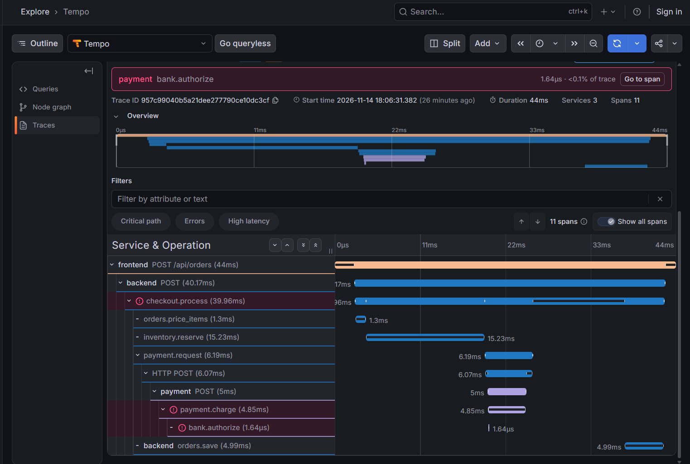
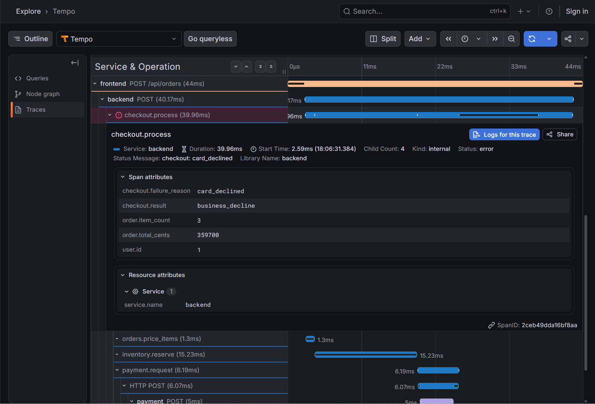
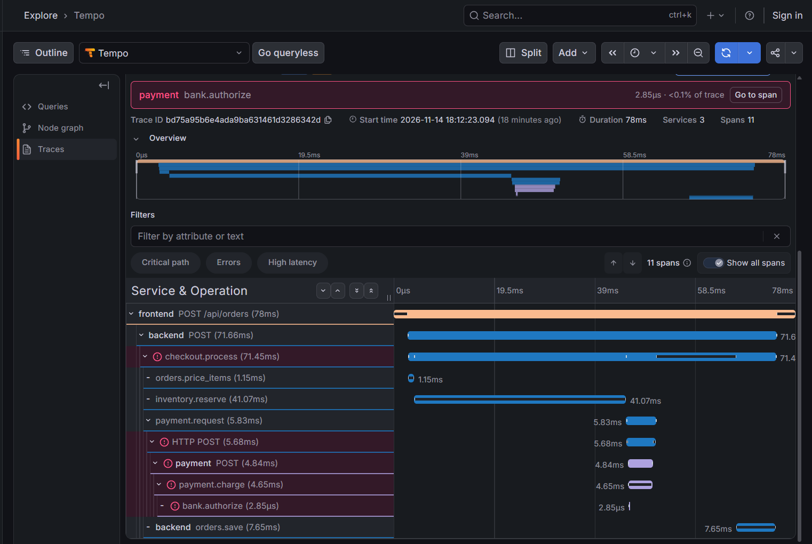
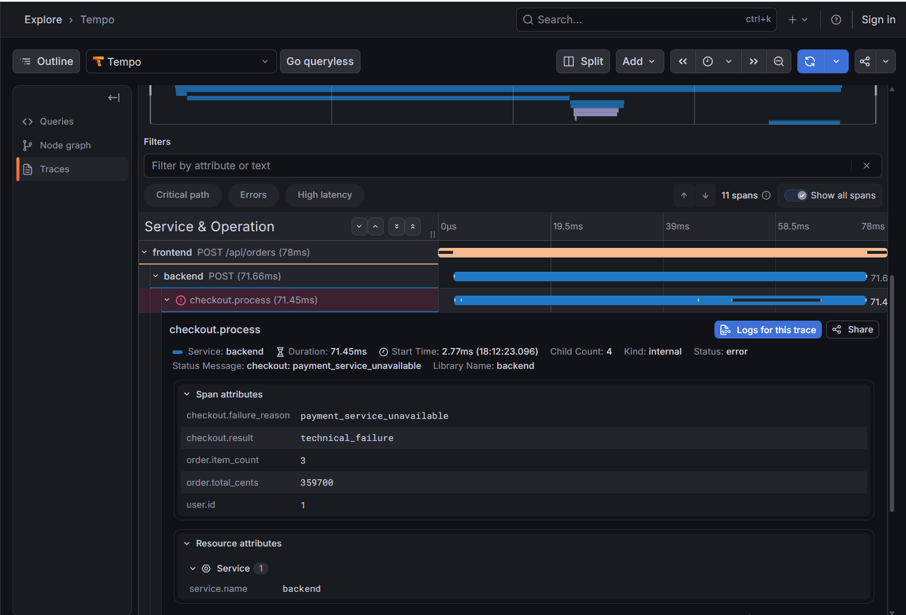
 
### Алерты: firing и resolved
 
Данные из лога alertreceiver (UTC):
 
| Алерт | Канал | firing -> resolved |
|---|---|---|
| CheckoutPaymentsFailing | oncall-webhook | 15:12:59 -> 15:14:29; 15:21:39 -> 15:22:39 |
| CheckoutZeroPurchases | oncall-webhook | 15:12:29 -> 15:15:29; 15:21:09 -> 15:23:39 |
| CheckoutCardDeclinedSpike | ticket-webhook | 14:53:59 -> 14:55:59; 15:09:44 -> 15:12:44; 15:19:39 -> 15:22:14 |
 
При техническом сбое CheckoutZeroPurchases (`for: 0s`) загорается раньше, CheckoutPaymentsFailing (`for: 30s`) загорается примерно на 30 секунд позже. Скриншоты 01 и 02 сняты на первой версии правила 2, подробности в разделе 4.
 
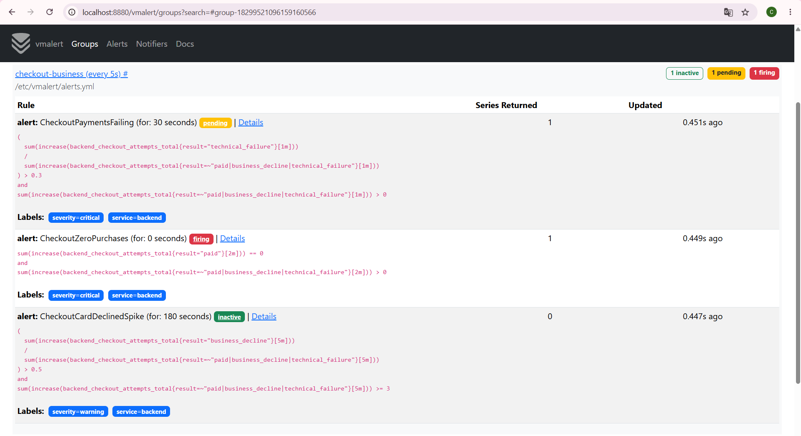
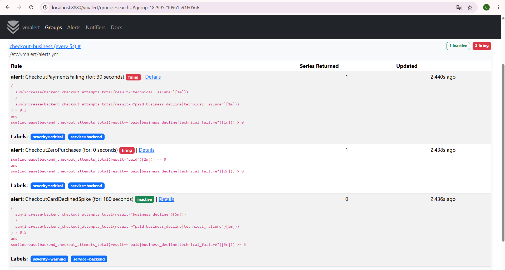
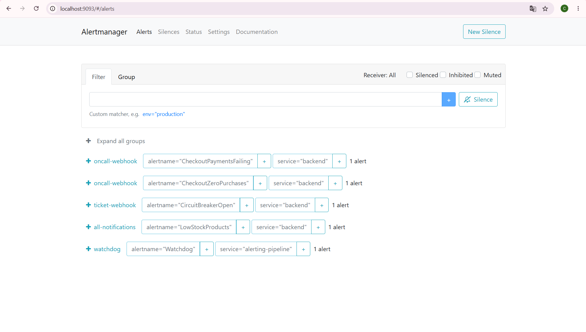
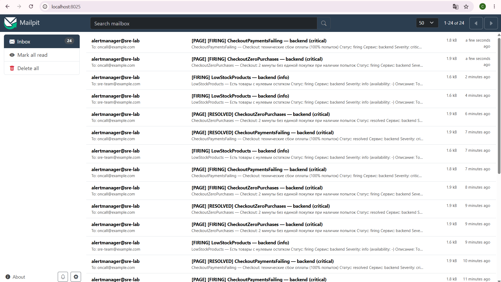
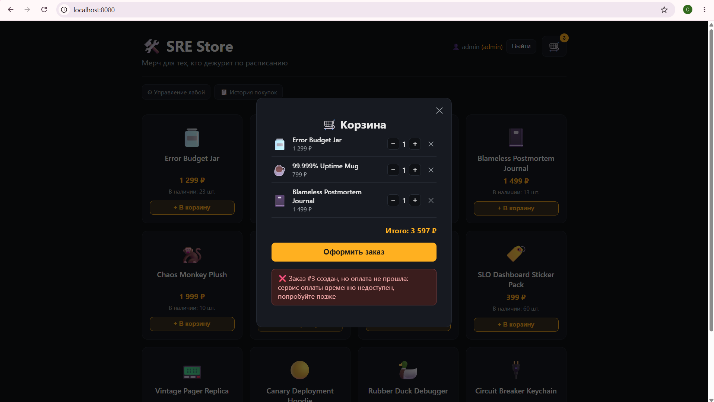
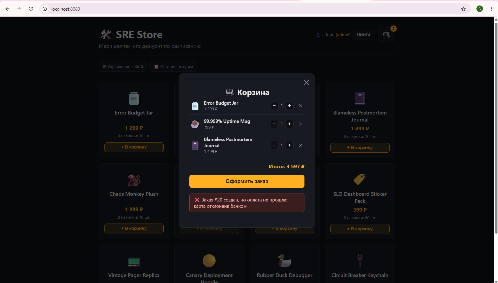
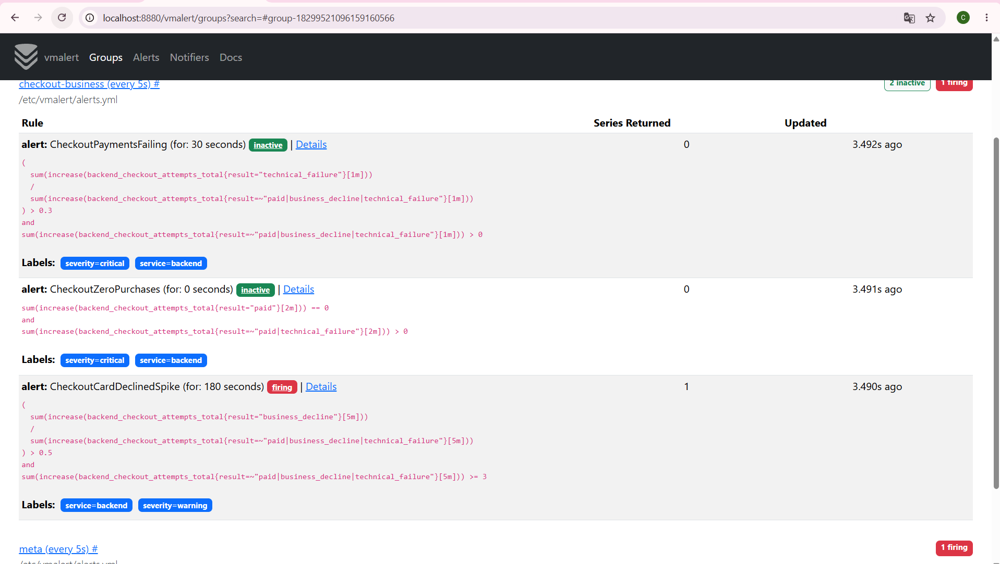
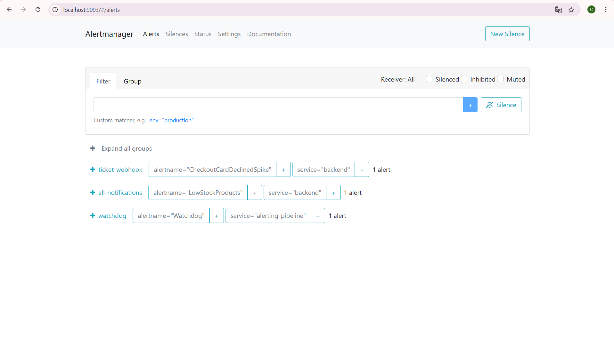
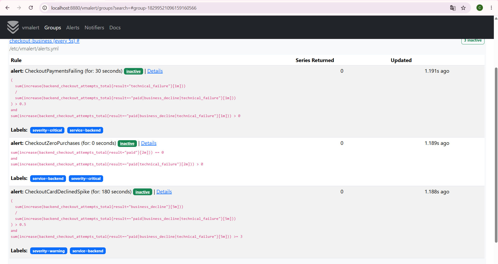
 
### Маршрутизация и ингибирование
 
В логе alertreceiver поле `receiver` показывает маршрут: `critical` -> `oncall-webhook`, `warning` -> `ticket-webhook`, `info` -> `all-notifications`.
 
Ингибирование я проверил на двух тестовых алертах: `CheckoutCardDeclinedSpike state=suppressed inhibitedBy=f70d514e2a33ad75`. На реальных алертах повторить не получилось: они горят одновременно всего несколько секунд из-за разных окон (1 минута и 5 минут). Поэтому проверена конфигурация правила.
 
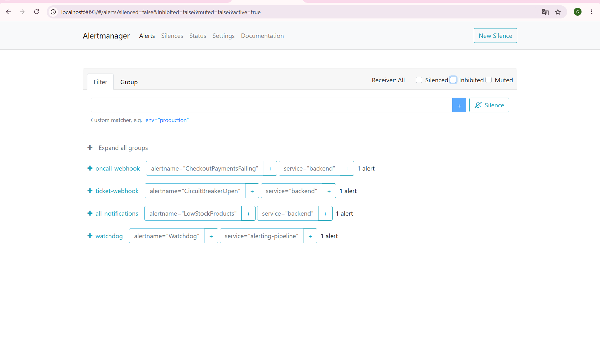
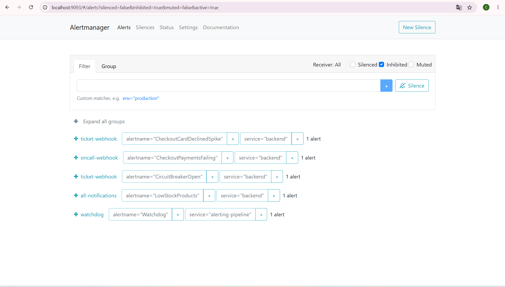
 
## 4. Алерты
 
| Правило | Что проверяет | Порог | for | severity и маршрут |
|---|---|---|---|---|
| CheckoutPaymentsFailing | доля технических сбоев среди попыток оплаты | больше 30% за 1 минуту, есть попытки | 30 с | critical, page (oncall-webhook) |
| CheckoutZeroPurchases | за 2 минуты нет ни одного `paid`, но есть технические сбои | `paid == 0` и `paid + technical_failure > 0` за 2 минуты | 0 с | critical, page (oncall-webhook) |
| CheckoutCardDeclinedSpike | всплеск бизнес-отказов | больше 50% за 5 минут, минимум 3 попытки | 3 мин | warning, ticket (ticket-webhook) |
| Ингибирование | page уже горит | CheckoutPaymentsFailing подавляет CheckoutCardDeclinedSpike, `equal: [service]` | - | - |
| Маршрутизация | critical и warning идут в разные каналы | critical: `group_wait 0s`, повтор 2 минуты; warning: `group_wait 30s`, повтор 10 минут; `group_by [alertname, service]` | - | - |
 
**Обоснование порогов**
 
- Правило 1: я использую долю, а не количество, чтобы алерт не зависел от трафика. В числитель входит только `technical_failure`, поэтому `card_declined` в него попасть не может. Чтобы не было деления на ноль, добавлено условие "попыток больше 0". `for: 30s` я выбрал потому, что при сбое покупатель не может оплатить заказ сразу, а 30 секунд защищают от одного неудачного скрейпа.
- Правило 2: окно в 2 минуты уже есть в выражении, поэтому `for: 0s`. Условие "были попытки" отличает ситуацию "никто не покупает" (тишина, алерта нет) от ситуации "покупают, но оплата не проходит".
- Правило 3: один отказ карты это нормальная ситуация, поэтому нужен порог по доле, минимум 3 попытки и `for: 3m` (больше, чем у правила 1).
**Почему у card_declined нет page.** Отказ карты это штатный ответ банка, сервис оплаты работает правильно. Дежурный ничего исправить не может, поэтому для этого случая только warning и тикет.
 
**Ошибка в первой версии правила 2.** Сначала я считал "попытками" и `business_decline` тоже. При эксперименте с `card_declined` (технических сбоев не было) правило CheckoutZeroPurchases отправило page в `oncall-webhook` (14:30:09 и 14:32:39). Я убрал `business_decline` из условия "были попытки". После исправления в повторных прогонах отказов карт (15:09-15:12) page не приходил.
 
**Проверка тихого времени.** Я заново запустил стенд, поэтому все счетчики `backend_checkout_attempts_total` стали равны 0. Запросы на оформление заказа я не отправлял. Запрос `sum(increase(backend_checkout_attempts_total{result="paid"}[2m]))` вернул 0, то есть левая часть CheckoutZeroPurchases истинна. Но запрос `sum(increase(backend_checkout_attempts_total{result=~"paid|technical_failure"}[2m]))` тоже вернул 0: попыток нет, поэтому правило осталось inactive. Без условия "были попытки" оно бы сработало. В логе alertreceiver новых уведомлений Checkout нет.
 
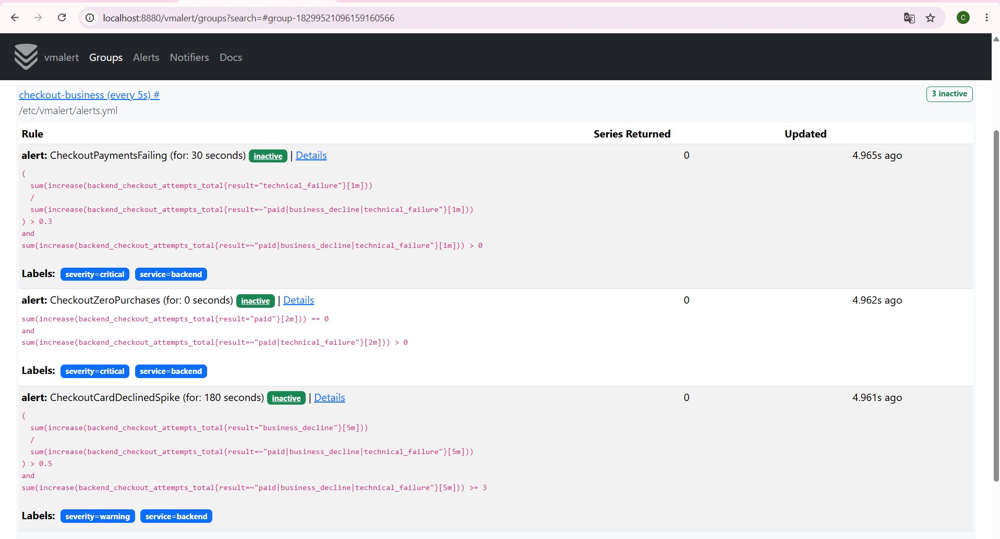
 
## 5. Вывод о поведении checkout
 
| | технический сбой (issuer_timeout) | card_declined |
|---|---|---|
| ответ payment backend'у | HTTP 504 | HTTP 200, `status=declined` |
| circuit breaker | после 3 сбоев подряд открывается | остается closed |
| лог backend | `ERROR checkout failed: payment service degraded` | `WARN checkout failed: card declined` |
| метрика | `technical_failure` | `business_decline` |
| сообщение на витрине | "сервис оплаты временно недоступен" | "карта отклонена банком" |
| алерт | critical, page | warning, ticket |
 
В обоих случаях клиент получает HTTP 402, в общем логе пишется `ERROR POST /api/orders -> 402`, а спан `checkout.process` получает статус `error`. Поэтому по HTTP-кодам и стандартным логам отказ карты нельзя отличить от аварии. Алерт на долю 5xx оплату тоже не видит, потому что backend отвечает 402. Различить случаи позволяет только добавленный `result`.
 
**SLI по оплате** - доля попыток оплаты, которые система обработала правильно:
 
```promql
1 - sum(increase(backend_checkout_attempts_total{result="technical_failure"}[30d]))
    / sum(increase(backend_checkout_attempts_total{result=~"paid|business_decline|technical_failure"}[30d]))
```
 
Хорошие события: `paid` и `business_decline` (система дала правильный ответ). Плохие события: `technical_failure`. Отказ карты не ухудшает SLI, потому что сервис оплаты работает. Долю одобрения `paid / (paid + business_decline)` я бы отслеживал отдельно, как бизнес-показатель.
 
## Runbook: оплата не проходит
 
**CheckoutPaymentsFailing и CheckoutZeroPurchases (page)**
 
- Проверка: `curl.exe -s http://localhost:8081/healthz` (состояние `payment_cb`); `curl.exe -s http://localhost:8083/admin/chaos` (не включен ли тестовый сбой); причина в логе payment: `docker compose logs payment --since 10m | Select-String "payment_bank_rejected"`.
- Безопасные действия: если включен тестовый сбой, выключить его (доля отказов 0). Если сбой на стороне банка или провайдера, сообщить владельцу интеграции. Breaker закроется сам после первой успешной оплаты.
- Эскалация: если оплата не восстановилась за 10 минут, передать владельцу сервиса payment.
- Не делать: не перезапускать backend (сбрасываются сессии и состояние breaker, причина остается неизвестной), не менять настройки breaker во время аварии, не оформлять заказы повторно вручную.
**CheckoutCardDeclinedSpike (ticket)**
 
- Проверка: убедиться, что CheckoutPaymentsFailing не горит (технических ошибок нет), и посмотреть, с какого времени выросла доля отказов.
- Безопасные действия: передать тикет владельцу платежной интеграции в рабочее время.
- Эскалация: если доля отказов держится больше часа, сообщить владельцу интеграции.
- Не делать: не поднимать дежурного (система работает), не повторять оплаты.


Pull request: https://github.com/dakmaev1440/sre-observability-lab/pull/1